<!-- Hero -->

<picture>
  <source media="(prefers-color-scheme: dark)" srcset="./assets/hero_dark.svg">
  
</picture>

  
  
  
  
  

 

<!-- About Me -->

<picture>
  <source media="(prefers-color-scheme: dark)" srcset="./assets/section_about_dark.svg">
  
</picture>

<b>삶을 윤택하게 만드는 개발자</b>, 이준혁입니다. 
작은 나무인 기능 단위보다 큰 숲인 전체 흐름을 먼저 보고 문제를 해결합니다.

 

- **관심 분야**: Backend, DevOps, Cloud, Game Dev
- **학력**: 한양대학교 ERICA 컴퓨터학부 19학번 (2026.08 졸업)
- **교육**: SSAFY (삼성 청년 SW&middot;AI 아카데미) 16기 데이터 트랙, 대전 캠퍼스 (2026.07 ~)
- **이전 경력**: **Kakao Enterprise** IaaS 기술 기획 인턴 (2024.07 ~ 08) &middot; **K-Buddy** 백엔드 & DevOps (2023 ~ 2024) &middot; **GiftMusic** 백엔드 (2020 ~ 2021)
- **병역**: 대한민국 공군 825기 정보체계관리병, 31전대 병장 만기전역 (2021.04 ~ 2023.01)
- **더 알아보기**: [bnbong.com](https://bnbong.com/)

 

<picture>
  <source media="(prefers-color-scheme: dark)" srcset="./assets/journey_dark.svg">
  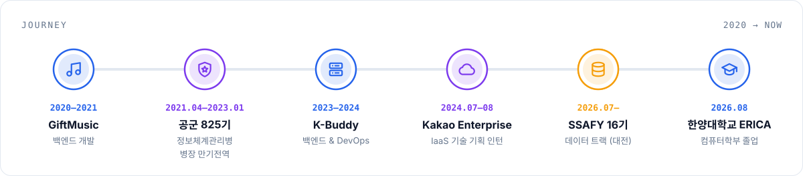
</picture>

 

<!-- Featured Projects -->

<picture>
  <source media="(prefers-color-scheme: dark)" srcset="./assets/section_projects_dark.svg">
  
</picture>

<table>
  <tr>
    <td width="50%" align="center" valign="top">
      <a href="https://github.com/bnbong/VastHorizon">
        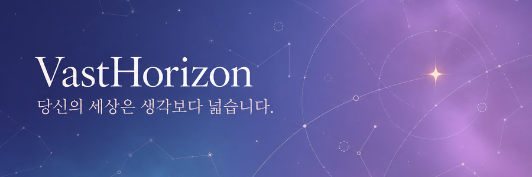
      </a>
       
      <b><a href="https://github.com/bnbong/VastHorizon">VastHorizon</a></b> 
      별 하나를 알아갈 때마다 내 세계가 넓어지는, 사실로 위로하는 RAG 기반 우주 안내서 
      <a href="https://vasthorizon.bnbong.com">vasthorizon.bnbong.com</a>
        
      
      
      
      
    </td>
    <td width="50%" align="center" valign="top">
      <a href="https://github.com/bnbong/Astralopithecus">
        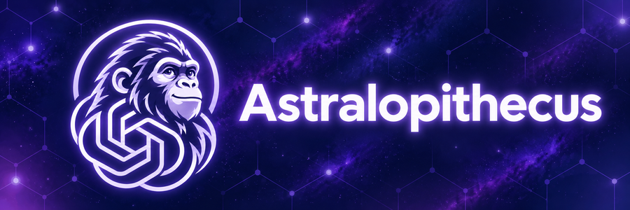
      </a>
       
      <b><a href="https://github.com/bnbong/Astralopithecus">Astralopithecus</a></b> 
      이미지 속 글자를 읽어 정답을 고르는 한국어 VQA 모델, SSAFY 16기 2회차 AI 챌린지 Public 0.97765 (팀장)
        
      
      
      
      
    </td>
  </tr>
  <tr>
    <td width="50%" align="center" valign="top">
      <a href="https://github.com/bnbong/FastAPI-fastkit">
        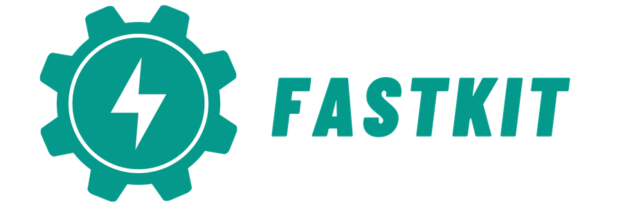
      </a>
       
      <b><a href="https://github.com/bnbong/FastAPI-fastkit">FastAPI-fastkit</a></b> 
      FastAPI 프로젝트 초기 구성을 CLI와 템플릿으로 자동화한 오픈소스 패키지 (PyPI)
        
      
      
      
    </td>
    <td width="50%" align="center" valign="top">
      
       
      <b><a href="https://github.com/bnbong/Wegis">Wegis</a></b> 
      멀티모달 AI 기반 QR/URL 브라우저 보호형 피싱 탐지 확장 프로그램 서비스
        
      
      
      
    </td>
  </tr>
  <tr>
    <td width="50%" align="center" valign="top">
      <a href="https://github.com/bnbong/CNN-QR-phishing-detector">
        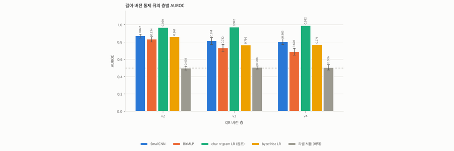
      </a>
       
      <b><a href="https://github.com/bnbong/CNN-QR-phishing-detector">CNN-QR-phishing-detector</a></b> 
      QR 모듈 격자만으로 피싱 URL을 판별할 수 있는지 통제 실험으로 검증하고 논문화 중인 연구
        
      
      
    </td>
    <td width="50%" align="center" valign="top">
      <a href="https://github.com/bnbong/Overlock">
        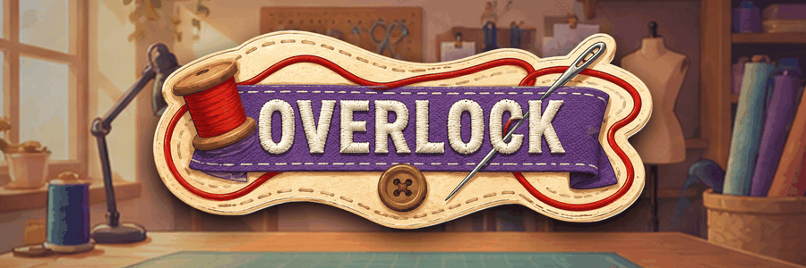
      </a>
       
      <b><a href="https://github.com/bnbong/Overlock">Overlock</a></b> 
      재봉틀 노루발로 원단 위 재봉선을 박는 웹 타임어택 게임 (Godot + FastAPI 리더보드 서버) 
      <a href="https://overlock.bnbong.com">overlock.bnbong.com</a>
        
      
      
    </td>
  </tr>
  <tr>
    <td width="50%" align="center" valign="top">
      <a href="https://github.com/BNGdrasil">
        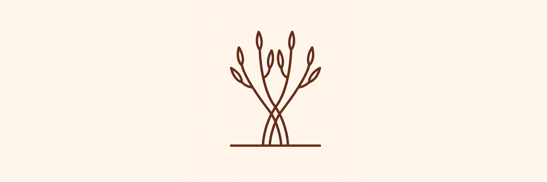
      </a>
       
      <b><a href="https://github.com/BNGdrasil">BNGdrasil</a></b> 
      개인 클라우드 플랫폼으로 운영중인 멀티 저장소 인프라 프로젝트 (FastAPI · Terraform · OCI)
        
      
      
      
      
    </td>
    <td width="50%" align="center" valign="top">
      <a href="https://github.com/bnbong/codemaru">
        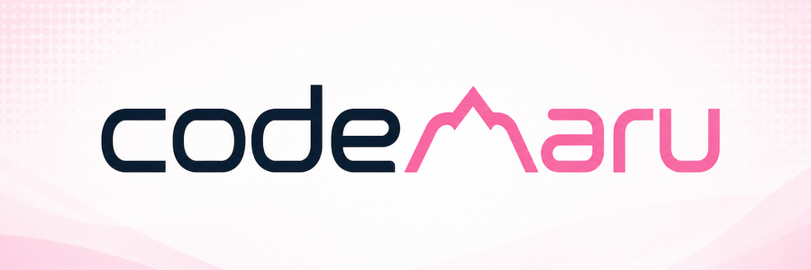
      </a>
       
      <b><a href="https://github.com/bnbong/codemaru">codemaru</a></b> 
      GitHub 프로필 README용 개발 역량 요약 SVG 카드 생성기 (아래 Stats 섹션의 카드가 바로 이것)
        
      
      
    </td>
  </tr>
</table>

 

<!-- Tech Stack -->

<picture>
  <source media="(prefers-color-scheme: dark)" srcset="./assets/section_stack_dark.svg">
  
</picture>

<picture>
  <source media="(prefers-color-scheme: dark)" srcset="./assets/stack_dark.svg">
  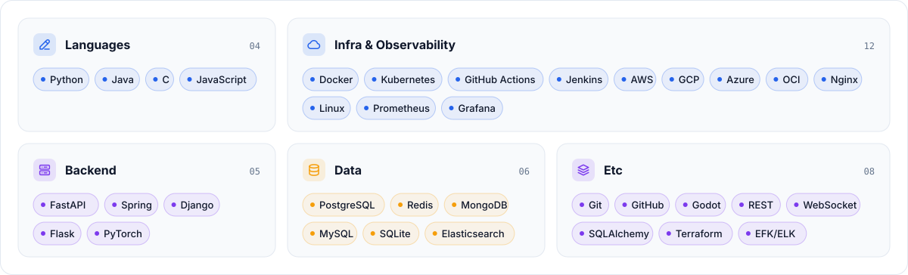
</picture>

 

<!-- My Recent Blog Posts -->

<picture>
  <source media="(prefers-color-scheme: dark)" srcset="./assets/section_blog_dark.svg">
  
</picture>

<table>
  <tr>
    <td width="50%" valign="top">
      <h3 align="center"><a href="https://blog.naver.com/bnbong">Daily</a></h3>
      

<!-- DAILY:START -->
 - [26년 10월](https://blog.naver.com/bnbong/224458707416?fromRss=true&trackingCode=rss)

 - [26년 9월](https://blog.naver.com/bnbong/224427635498?fromRss=true&trackingCode=rss)

 - [26년 8월](https://blog.naver.com/bnbong/224395254240?fromRss=true&trackingCode=rss)

 - [조Love](https://blog.naver.com/bnbong/224385787937?fromRss=true&trackingCode=rss)

 - [26년 7월](https://blog.naver.com/bnbong/224365970384?fromRss=true&trackingCode=rss)

 - [26년 6월](https://blog.naver.com/bnbong/224334227103?fromRss=true&trackingCode=rss)

 - [26년 5월](https://blog.naver.com/bnbong/224301894211?fromRss=true&trackingCode=rss)

 - [26년 4월](https://blog.naver.com/bnbong/224271005370?fromRss=true&trackingCode=rss)
<!-- DAILY:END -->

</td>
    <td width="50%" valign="top">
      <h3 align="center"><a href="https://bnbong.com/blog/">Tech</a></h3>
      
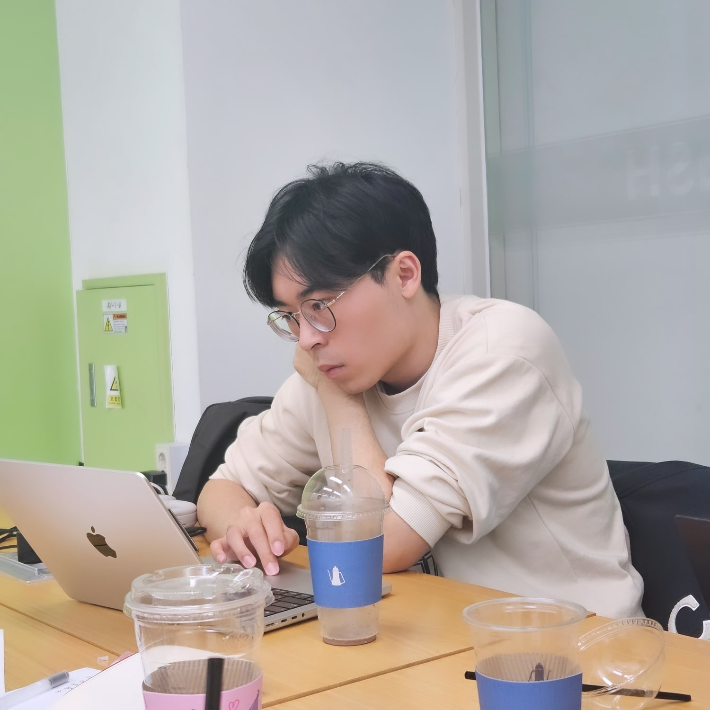

<!-- TECH:START -->
 - [[Project] VastHorizon 개발 기록](https://bnbong.com/blog/20261027-vasthorizon/)

 - [[Talk] SSAFY에서 발표한 AI 오케스트레이션 흐름과 한국 AI 전망](https://bnbong.com/blog/20261025-ssafy-ai-orchestration-talk/)

 - [[Python] SQLAlchemy AsyncSession에서 MissingGreenlet 에러가 반복되는 이유](https://bnbong.com/blog/20261015-sqlalchemy-missing-greenlet/)

 - [[Python] Python 비동기 DB 드라이버에 관하여](https://bnbong.com/blog/20261014-python-async-db/)

 - [[Project] Overlock v2.3.1 업데이트와 itch.io 배포](https://bnbong.com/blog/20261006-overlock-v2/)

 - [[자격증] 정보처리기사 합격 후기](https://bnbong.com/blog/20260915-engineer-information-processing-cert/)

 - [[알고리즘 리뷰] 다익스트라](https://bnbong.com/blog/20260913-cs-algorithms-5/)

 - [[알고리즘 리뷰] 이분 탐색 &amp; 이분 탐색 트리](https://bnbong.com/blog/20260902-cs-algorithms-4/)
<!-- TECH:END -->

</td>
  </tr>
</table>

 

<!-- My Programming Stats -->

<picture>
  <source media="(prefers-color-scheme: dark)" srcset="./assets/section_stats_dark.svg">
  
</picture>

<!-- Github Trophy -->

  

  
  

  

<picture>
  <source media="(prefers-color-scheme: dark)" srcset="https://raw.githubusercontent.com/bnbong/bnbong/output/github-contribution-grid-snake-dark.svg">
  
</picture>

 

<!-- Footer -->

<picture>
  <source media="(prefers-color-scheme: dark)" srcset="./assets/footer_dark.svg">
  
</picture>

<!---
bnbong/bnbong is a ✨ special ✨ repository because its `README.md` (this file) appears on your GitHub profile.
You can click the Preview link to take a look at your changes.
--->
